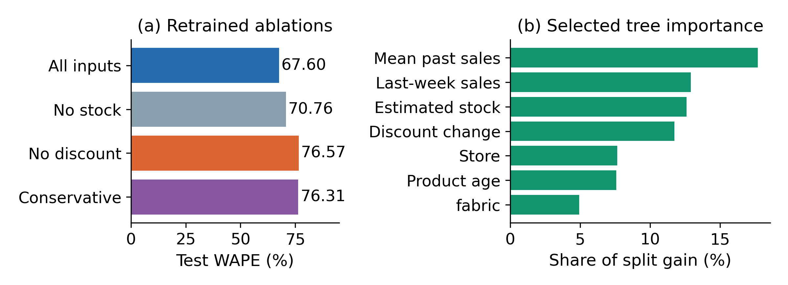

# Retail Discount Response

Khush Bhavin Maru · COMP5064 / PAIML2

This project forecasts the next week’s observed unit sales for a fashion product at a store after its first week on sale. It compares sales-history and seasonal features, start-of-week stock estimates and planned discounts across LightGBM, neural networks and simple baselines. A piecewise neural model constrains predicted sales to increase or stay flat as the supplied discount rises, with other inputs fixed.

## My contribution

For COMP5064, I built and evaluated models for forecasting next-week observed unit sales. The coursework covers the timing of forecast inputs, comparisons with historical sales baselines, and discount-sensitivity analysis with historical support checks. The published repository includes the corrected evaluation, input checksums, report and slides.

## Interview dashboard

Run `python portfolio_demo.py` from the repository root and open http://127.0.0.1:8002. The aggregate mode uses the reported model comparisons and discount-support checks and runs with the Python standard library.

With local access to the original evidence archive, install the modelling dependencies and launch:

```sh
python portfolio_demo.py --evidence /path/to/COMP5064_Evidence
```

The dashboard verifies the [archive inputs](docs/results/replay.sha256) before loading two seed-zero checkpoints and evaluates them at 61 discount settings on the first historical test context with a recorded discount. It keeps the other inputs fixed. The observed sales and discount come from that historical context. The support chart describes a separate sample of 10,000 test contexts and covers seven tested levels. It should not be read as a support rating for the example. [Reproduction and access requirements](docs/reproduce.md)

## Results

On 405,992 historical product–store–week rows, LightGBM Tweedie had the lowest mean WAPE among the evaluated models.

- **LightGBM Tweedie** · 67.48% WAPE
- **Poisson MLP** · 69.50% WAPE
- **Monotone piecewise network** · 72.92% WAPE
- **Last-week baseline** · 97.31% WAPE

Model-family scores average three seeds. WAPE is the sum of absolute unit errors divided by the sum of observed units. The conservative-input tree scored 76.31% WAPE in a single run with target-week discount inputs and Google Trends removed.



See [experiment notes](docs/experiments.md) for the split, feature availability, ablations, scenario figures and limitations. See [reproduction steps](docs/reproduce.md) for the environment, data inputs and commands.

## Evaluation and reproduction boundaries

The reported WAPE scores come from a retrospective evaluation on the historical split. They estimate error in observed sales. Stock constraints and unavailable demand are outside the prediction target. The discount sweeps show how a fitted model's prediction changes with the supplied discount while holding other inputs fixed. Historical support varies across discount levels, and these predictions do not identify causal uplift or establish a pricing policy.

The public dashboard and its automated checks exercise the aggregate evidence without the original archive. Checkpoint replay and model refitting follow separate procedures with additional inputs listed in the [reproduction guide](docs/reproduce.md).

## Dataset, presentation and report

- [VISUELLE 2.0 input CSVs](datasets/visuelle2/) and [verification steps](docs/reproduce.md#verify-the-source-csvs).
- [Final report (PDF)](docs/materials/COMP5064-Final-Report.pdf).
- [Presentation (PowerPoint)](docs/materials/COMP5064-Presentation.pptx). The visible talk reflects the final study. Hidden backup slides retain historical material.

## Credits

Coursework by Khush Bhavin Maru. The preserved source files were imported from the supplied final evidence snapshot. New repository packaging and documentation were prepared with Codex.

Dataset from Humatics Lab and Nuna Lie. Cite Geri Skenderi, Christian Joppi, Matteo Denitto, Berniero Scarpa and Marco Cristani. *The Multi-Modal Universe of Fast-Fashion: The Visuelle 2.0 Benchmark*, CVPR Workshops, 2022, pp. 2241–2246. [Dataset and access form](https://humaticslab.github.io/forecasting/visuelle) · [Paper](https://openaccess.thecvf.com/content/CVPR2022W/CVFAD/html/Skenderi_The_Multi-Modal_Universe_of_Fast-Fashion_The_Visuelle_2.0_Benchmark_CVPRW_2022_paper.html)
